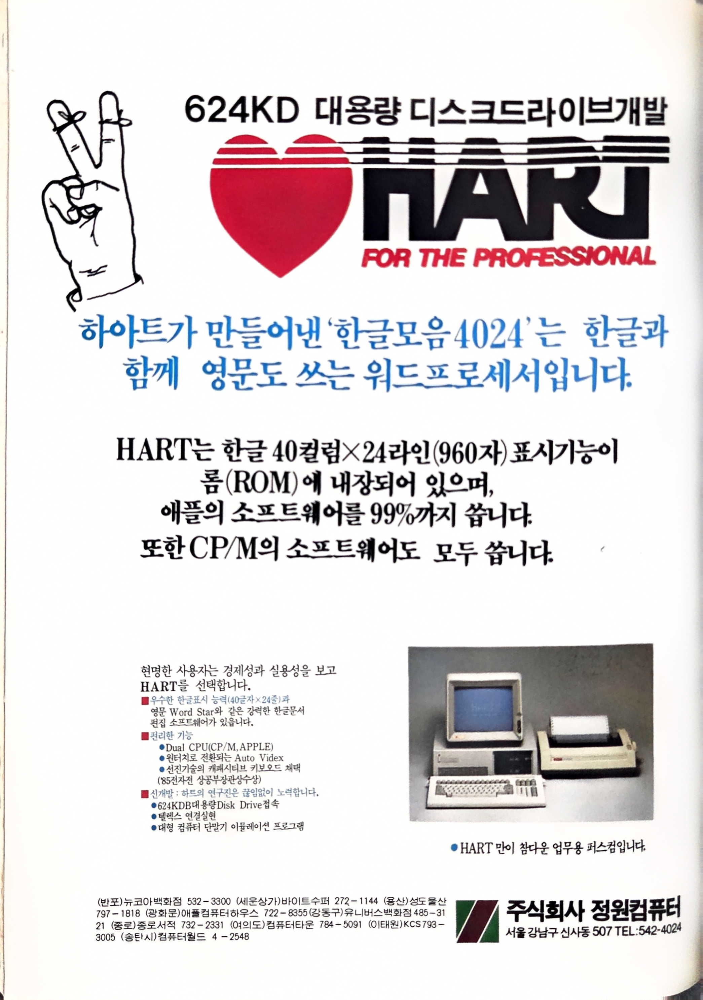
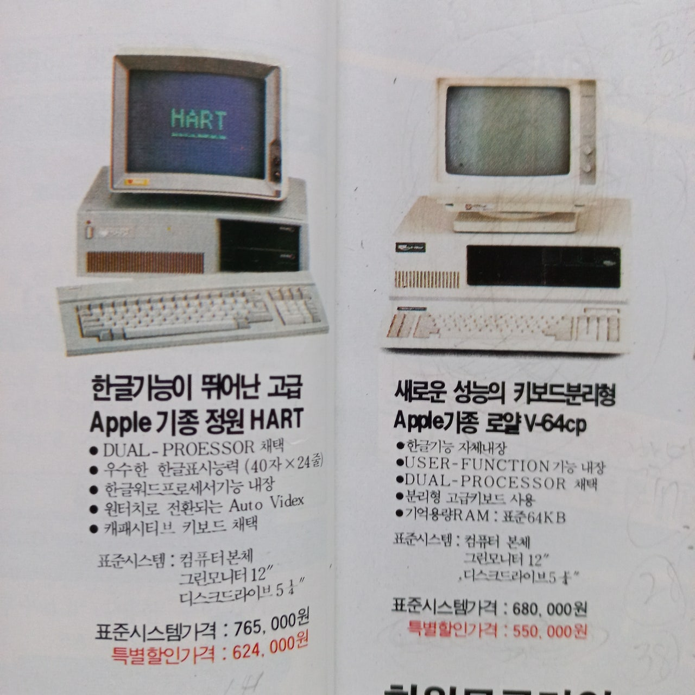
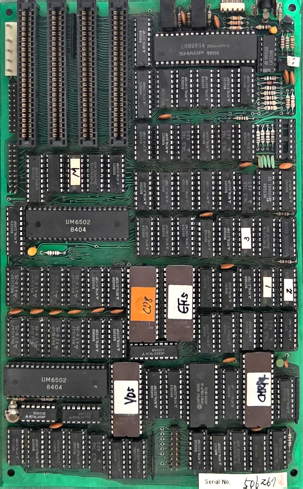
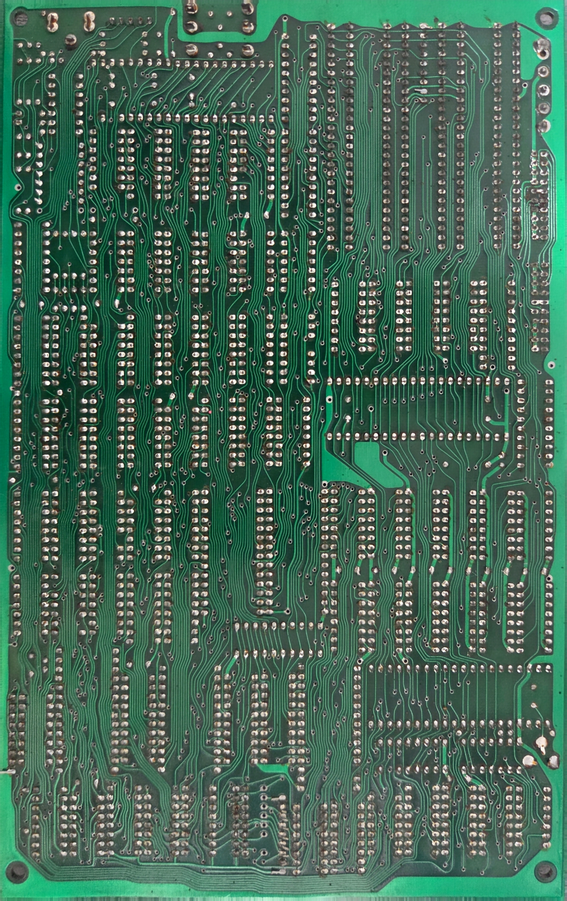
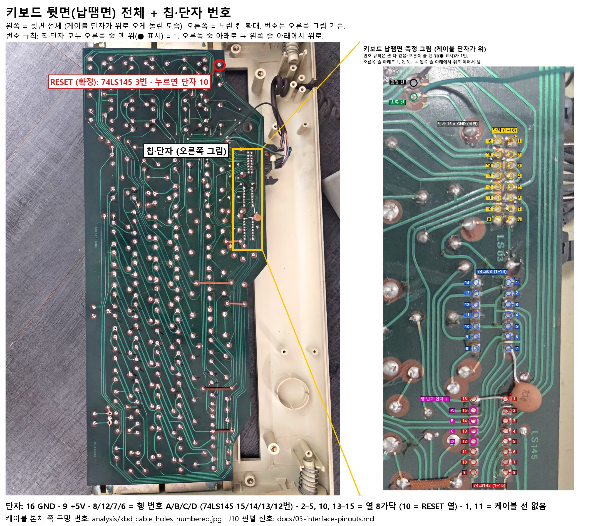

# HART: Apple II 클론 보드 리버스 엔지니어링

S/N 506267 Apple II 호환 메인보드의 사진, 부품 분석, 회로도를 정리한 저장소입니다.
이 보드는 6502 메인 CPU에 **Z80 서브시스템**과 **두 번째 6502**가 함께 실장된 형태로, 일반 Apple II와 구성이 다릅니다.

<p align="center"><a href="photos/ad/20261113_063659_HART-magazine-ad_Zungwon.jpg"></a> <a href="photos/ad/20211008_075758_HART-and-Royal-V64cp_catalog-ad.jpg"></a></p>

당시 광고. 왼쪽은 잡지 광고 (주식회사 정원컴퓨터, 서울 강남구 신사동): 한글 40×24 표시 롬 내장, Dual CPU(CP/M·APPLE), 원터치로 전환되는 Auto Videx, 캐패시티브 키보드, 624KDB 대용량 디스크 드라이브 접속. 오른쪽은 판매 광고로 **왼쪽 기기가 "Apple 기종 정원 HART"** 입니다 (오른쪽 기기는 다른 회사 제품 로얄 V-64cp). 표준시스템(본체·12" 그린 모니터·5¼" 드라이브) 765,000원, 특별할인 624,000원.

| 앞면 (부품면) | 뒷면 (납땜면) |
| --- | --- |
| <a href="photos/overview/front/202813_front-flat_layout-ref.jpg"></a> | <a href="photos/overview/back/203240_back-flat_registration-ref.jpg"></a> |

사진을 누르면 원본 크기로 볼 수 있습니다. 뒷면은 앞면과 좌우가 뒤집혀 있습니다 (보드를 옆으로 뒤집은 방향). 다른 사진은 [`photos/README.md`](photos/README.md)에 정리되어 있습니다.

## 현재 상태

| 항목 | 상태 |
| --- | --- |
| 부품 식별 (IC 85개, 커넥터·트랜지스터 등 17개) | 완료. 일부 지워진 표기는 추정 |
| 기능 블록 회로도 | 완료 (Apple II 표준 설계 기반 추정 포함) |
| 부품 배치도 | 완료 |
| 앞면 확대 사진 | 27장 (기존 18장 + 2026-11-07 추가 9장, 추가분은 앞면 기준 사진에 위치 맞춤) |
| 뒷면 확대 사진 | 14장, 13장은 뒷면 기준 사진에 정합 완료 |
| 앞면·뒷면 정합 | 완료 (2026-11-07). 비아 205개 기준 평균 오차 약 2px → [`analysis/back_on_front.jpg`](analysis/back_on_front.jpg) |
| 핀 단위 결선 (넷리스트) | 진행 중. `data/netlist.csv` (U64 버스·클럭 분리, Φ0 배선, 슬롯 방향) |
| ROM / PROM 덤프 | 미완료 |
| 키보드 (ZPC-40) | **정상 동작 확인 (2026-11-08)**. 키 입력 됨, Ctrl+RESET에 "삑". 케이블 결선 전부 확인. 일부 키는 스위치 접점 불량 → 아래 "키보드" |
| 수리 (화면 안 나옴) | **화면 복구 (2026-11-07)**. 원인: 소켓 접촉 불량. **남은 문제 3가지**(가끔 안 켜짐 — 클럭 없음, 오래 켜면 화면 지글거림, 키보드 일부 키) → 아래 "알려진 문제". 기록: [`docs/08-repair-log.md`](docs/08-repair-log.md) |

> **전원**: SMPS 단자·선 색·재는 곳은 [`analysis/power_reference.jpg`](analysis/power_reference.jpg) (보드 J1 핀별 전압·FDD 단자 핀 번호 포함). 이 기계는 **빨강 = +12V, 주황 = +5V** (일반 관례와 다름).

> **다시 고장 나면 먼저 [`docs/09-verified-baseline.md`](docs/09-verified-baseline.md)** 를 보세요. 수리 이력, 정상 동작 때 측정값(전원·클럭·키보드), 확인된 배선, 측정 실수 사례, 점검 순서를 모아 두었습니다.

## 알려진 문제와 점검 방법

**남은 문제 3가지 (2026-11-09 기준, 미해결)** — 이미 한 측정·결론은 [`docs/09-verified-baseline.md`](docs/09-verified-baseline.md) 6절 "진행 중인 문제"에 있으니 **같은 측정을 반복하지 말 것**.

| # | 문제 | 지금까지 결론 (확인) | 다음에 할 일 |
| --- | --- | --- | --- |
| 1 | **가끔 안 켜짐** (까만 화면, 드라이브 안 돎). 켜 둔 채 기다리거나 껐다 켜면 켜질 때도 있음 | 안 켜질 때 CPU 클럭·7M(슬롯 36)이 모두 없음 = **14MHz 발진 멈춤** (14MHz 자체는 테스터 GD128 범위(최대 9.999MHz) 밖이라 7M으로 판단). 전원·리셋·U72 칩은 배제. **트리머를 건드리자 바로 켜짐 (2026-11-09) → 원인 = 트리머 접촉 불량 (유력)** | 트리머 접점 청소 또는 교체 (원래 위치 표시 후). 그 뒤 여러 번 껐다 켜서 확인 |
| 2 | **화면 지글거림**: 오래 켜 두면 생길 때가 있음. FDD 없이도 생김 | 원인 미확인 | 지글거릴 때 슬롯 +5V DC·AC, 영상 케이블, 뜨거운 칩, 칩 두드리기 → [`analysis/jitter_check_points.jpg`](analysis/jitter_check_points.jpg) |
| 3 | **키보드 일부 키 안 눌림** | 회로·케이블 정상, 키 스위치 접점 문제 | 키보드 청소 (아래 주의) |

- 당장 쓸 때: **끄고 10초 이상 기다렸다가 켜기**, 안 켜지면 켜 둔 채 잠시 기다리기
- 안전: 안 켜진 상태 자체는 부품을 상하게 하지 않음. 고치기 전까지 켜 둔 채 자리 비우지 않기. 타는 냄새·손 못 댈 열·+5V 5.25V 초과면 바로 끄기
- 키보드 청소: **기판(PCB)에는 물 대신 IPA(소독용 알코올)**. 키캡은 떼어 물·중성세제로 씻고 완전히 말린 뒤 끼움. 키 스위치 안은 접점 세정제나 IPA를 넣고 여러 번 눌러 줌

### 화면이 위아래로 두 번 겹쳐 보임 (모니터 조정)

같은 화면이 위아래 두 장으로 겹쳐 보이면 모니터의 **수직 동기(V-HOLD)** 가 안 맞은 것입니다. 모니터 뒷면·옆면의 V-HOLD(V.HOLD, VERT HOLD, V-FREQ) 손잡이를 천천히 돌려 화면이 한 장으로 멈추는 곳에 둡니다. 끝까지 돌려도 안 맞으면 컴퓨터 쪽 수직 동기 신호를 점검합니다.

### 측정 요령 (이번 수리에서 배운 것)

- **Hz 모드는 검정 프로브를 반드시 GND**(U30 핀 1, U72 핀 7, 슬롯 핀 26)에 두고, **값이 안정될 때까지 몇 초 기다린 뒤** 읽기. 기준점이 틀리거나 너무 빨리 읽으면 3.585MHz·70kHz 같은 엉뚱한 값이 나와 잘못된 판단을 하게 됨
- 테스터 **GD128의 Hz 범위는 최대 9.999MHz** → 14.318MHz(U72 발진 출력)는 못 읽음. 14MHz가 도는지는 **7M(슬롯 36, 약 7.16MHz)** 으로 확인
- Apple II 클럭 신호는 가끔 한 주기가 길어지는 모양이라 테스터가 헷갈리기 쉬움. 정밀하게 보려면 USB 로직 분석기나 오실로스코프 권장
- 도통(삐) 모드는 저항을 사이에 둔 연결을 잡지 못함. 연결이 의심되면 저항(Ω) 모드로도 확인
- 같은 번호 슬롯 핀은 모두 연결되어 있으므로, 재기 쉬운 슬롯 핀을 측정점으로 쓰면 편함
- **아주 짧은 펄스(키보드 스캔 등)는 테스터 Hz로 못 셈** (0Hz로 나옴). 이럴 때는 **DC V로 평균 전압을 비교**: 예) RESET 뗌 4.9V → 누름 3.8V면 신호가 지나가는 것
- 테스터 **"O.L"** 표시 = 안 통함(범위 초과). 0Ω과 반대 뜻이니 헷갈리지 말 것
- 아무 데도 안 이어진(떠 있는) 핀은 Hz 모드에서 전기 배선 잡음 **60Hz**가 잡힐 수 있음 → 의미 없는 값

## 키보드 (ZPC-40)

키보드 명판은 "PERSONAL COMPUTER ZPC-40"입니다(본체 모델명인지는 **조사 필요**). 사진은 [`photos/keyboard/`](photos/keyboard/), 측정 기록은 [`docs/08-repair-log.md`](docs/08-repair-log.md)에 있습니다.

> **주의: 정품 Apple II 키보드와 서로 바꿔 끼울 수 없습니다.** 신호 방식과 커넥터 핀 배치가 모두 다릅니다. 케이블 커넥터에 방향 돌기가 없으므로 반드시 아래 방향대로 꽂으세요.

### 정품 Apple II 키보드와 다른 점

| 항목 | 정품 Apple II (II/II+) | HART (ZPC-40) |
| --- | --- | --- |
| 키보드 안 칩 | 키 인코더(AY-5-3600 등)가 키를 ASCII 코드로 바꿈 | **74LS145 + 74LS03뿐**. 키 코드를 만드는 칩 없음 (확인) |
| 본체로 가는 신호 | 완성된 글자 코드 7비트 + STROBE | 본체가 행 번호 4비트(A·B·C·D)를 보내고, 키보드는 열 선으로 돌려줌 = **본체가 키 매트릭스를 직접 스캔** (확인) |
| RESET 키 | 리셋 회로로 바로 가는 별도 선 | **매트릭스 안의 일반 키** (74LS145 3번 = 행 2 × 단자 10, 확인). **Ctrl+RESET**이어야 리셋("삑"), RESET만은 무시 (확인) |
| Ctrl 키 | 인코더로 가는 별도 입력 | **동작 확인** (Ctrl+RESET 동작으로 본체까지 전달됨, 2026-11-08). 매트릭스 위치(행·열)·연결 방식은 **미측정**. Ctrl+RESET 조합을 하드웨어가 판정하는지 ROM이 판정하는지도 미확인 |
| 커넥터 전원 핀 | 16핀, 1번 +5V, 8번 GND | 한쪽 끝 2핀 GND, 반대쪽 끝 한 핀 +5V (확인) |
| 키 배치 | 대문자 52키 안팎, 화살표 ←→만, REPT 키 | 한글 자판·한글 키, F1–F12, 숫자 키패드, 화살표 4방향, Tab, Del, Alpha Lock, Vdx, Disp |

### 키보드 단자 (키보드 납땜면, 번호는 [`analysis/kbd_measure_simple.jpg`](analysis/kbd_measure_simple.jpg) 기준)

뒷면 전체와 칩·단자 번호·RESET 위치를 한 장에: [`analysis/kbd_solder_overview.jpg`](analysis/kbd_solder_overview.jpg)



| 단자 | 역할 | 상태 |
| --- | --- | --- |
| 16 | GND | 확인 |
| 9 | +5V | 확인 |
| 8 · 12 · 7 · 6 | 행 번호 A · B · C · D (74LS145 입력) | 확인 |
| 11 | 추가 선택선 (74LS03 게이트 입력, 행을 늘리는 용도로 추정). 케이블에 선 없음 (추정) | 용도 **조사 필요** |
| 2·3·4·5·10·13·14·15 | 열 선 8가닥 (본체가 4.9V로 당겨 둠, 키를 누르면 내려감). 10 = RESET 키 열 | 10 확인, 나머지는 열 선으로 추정 (8가닥 = U80/U81 입력 수와 같음) |
| 1 | 케이블에 선 없음 (추정) | - |

**케이블 결선** (본체 쪽 케이블 소켓 → 키보드 단자, 2026-11-08 전부 확인, 14가닥 정상): 1→9(+5V), 2→10, 3→6(D), 4→12(B), 5→13, 6→14, 7→15, 8·9→16(GND), 10→2, 11→3, 12→4, 13→5, 15→7(C), 16→8(A), 14 = 빈칸. 소켓 번호는 [`analysis/kbd_cable_socket_numbered.jpg`](analysis/kbd_cable_socket_numbered.jpg) 기준. J10 핀별 신호 표: [`docs/05-interface-pinouts.md`](docs/05-interface-pinouts.md) "키보드 단자 J10".

### 꽂는 방향 (J10)

그림: [`analysis/kbd_plug_direction.jpg`](analysis/kbd_plug_direction.jpg)

- J10 **케이스 반대쪽 끝 2핀 = GND**, **케이스 쪽 끝 왼쪽 핀(SIP·U80 반대쪽 줄) = +5V** (둘 다 슬롯 핀과 도통으로 확인)
- 케이블 커넥터는 **글자(JAE…) 면 쪽 줄의 양 끝**이 GND와 +5V
- 꽂는 법: 글자 면 줄을 J10 왼쪽 줄에, GND 끝을 케이스 반대쪽으로
- 꽂은 뒤 전원 켜기 전에 도통 확인: 키보드 단자 9 ↔ 슬롯1 25번 **통함**, 단자 16 ↔ 슬롯1 26번 **통함**, 단자 9 ↔ 단자 16 **안 통함**

### 조사 필요

- [ ] **안 눌리는 키 접점 청소**: 동작은 정상이고 일부 키만 스위치 접점 불량 (2026-11-08, 사용자 판단)
- [ ] **Ctrl+RESET 뒤 화면이 그대로인 이유**: "삑"은 나지만 로고 화면 유지. 디스크 대기/모드 선택 화면으로 추정 → 기능키·Return·Disp·Vdx로 넘어가는지 시험
- [ ] **Vdx 키**: Videx(Apple II용 80컬럼 카드 회사) 호환 80컬럼 화면 전환으로 추정. 눌러서 확인
- [ ] **본체에서 키보드를 스캔하는 회로**: J10 옆 74LS257 두 개(U80·U81)와 SIP 저항 어레이가 열 선을 읽는 것으로 추정. 스캔 순서를 만드는 칩, 키 코드로 바꾸는 주체(전용 회로인지, 한글용 6502 U64인지)는 미확인
- [x] **스캔이 실제로 도는지**: 74LS145 A·B·C·D 입력 44.7 / 94 / 105 / 46 kHz로 모두 움직임 (2026-11-08)
- [x] **RESET 키가 본체에 닿는지**: Ctrl+RESET에 "삑" (2026-11-08)
- [ ] **74LS03 추가 행과 단자 11의 용도**
- [ ] **키보드 부품면 저항 1개의 역할** ([위치](analysis/kbd_resistor_location.jpg))
- [ ] **초록·검정 선**: 키보드 단자 위쪽 패드에 직접 납땜된 2가닥. RESET 선이 아님(측정). 용도 미확인
- [x] **케이블 14가닥의 대응**: 위 "케이블 결선" (2026-11-08)
- [x] **실제 동작 시험**: 키 입력·Ctrl+RESET 동작 (2026-11-08). 한글 전환은 미시험

## 보드 요약

| 항목 | 내용 |
| --- | --- |
| 제조사 | Zung Won Co., Ltd. (서울). 부팅 화면에 "HART" 로고와 "Zung Won Co.,Ltd. 542-3675 SEOUL KOREA" 표시 |
| 메인 CPU | UM6502 (UMC, 8404). 소켓 실장. 클럭(Φ0)은 U33 74LS367 버퍼를 거쳐 따로 공급 |
| 보조 CPU | Sharp LH0080A (Z80A). CP/M 카드 내장형 추정 |
| 두 번째 6502 | UM6502. 한글 폰트 처리 전용, 독립 동작 (2026-11-06 확인) |
| DRAM | MN4164P-25 ×8 = 64KB |
| SRAM | HM6116LP-3 2KB |
| ROM | 2764 ×4: "C/D8", "EF5"(시스템), "VD5", "CHR P4"(문자) |
| 확장 슬롯 | 50핀 ×4 (Woo Young). 앞면 기준 왼쪽 줄 26–50, 오른쪽 줄 25–1 (측정 확인) |
| 칩 방향 | 가로 칩: 1번 핀 왼쪽 아래 / 세로 칩: 1번 핀 오른쪽 아래 (앞면, 슬롯 위쪽 기준) |
| 내장 I/O | 게임 포트, 카세트 IN/OUT, 스피커, 컴포지트 비디오(RCA), RGB 출력(5핀) |
| 내장 FDD | Apple Disk II 방식 컨트롤러(U16–U20) 내장. 앞면 왼쪽 위 20핀 단자 2개(J2·J3) = 드라이브 1·2. Apple 드라이브(Disk II 호환) 연결용. 핀 1 방향·전원 핀은 연결 전에 측정으로 확인할 것 |
| IC 날짜 코드 | 8404 – 8509 (1984 – 1985년) |

## 디렉터리 구성

```
HART/
├── README.md                     이 문서
├── photos/
│   ├── README.md                 사진 목록과 설명
│   ├── overview/front/, back/    보드 전체 사진 (앞 3, 뒤 2)
│   ├── zoom/front/, back/        확대 사진 (앞 18 + add_20261107 9, 뒤 14)
│   └── screen/                   모니터 화면 사진 (부팅 로고)
├── docs/
│   ├── 01-overview.md            분석 개요와 판독 범위
│   ├── 02-system-architecture.md 시스템 구성과 기능 블록
│   ├── 03-bom.md                 부품표 전체
│   ├── 04-open-questions.md      미확인 사항
│   ├── 05-interface-pinouts.md   슬롯·게임 포트 핀 배치, 소프트스위치 주소
│   ├── 06-next-steps.md          결선 확정 절차, 추가 촬영 가이드
│   ├── 07-back-trace-notes.md    뒷면 확대 사진 정합과 U64 핀맵
│   ├── 08-repair-log.md          수리 점검 기록 (날짜별 원자료)
│   └── 09-verified-baseline.md   확인된 사항·정상 기준값·고장 시 점검 순서
├── schematic/
│   ├── apple2-clone-schematic.html  인터랙티브 블록 회로도 + 배치도 + 부품표
│   └── src/                      HTML 생성 스크립트 (gen.py + 템플릿)
├── analysis/                     분석·측정용 그림 (핀 번호, 정합 사진, Φ0 경로 등)
├── tools/                        사진 정합·그림 생성 스크립트 (Python, OpenCV, Pillow)
└── data/
    ├── bom.csv                   부품 데이터 (배치 좌표 포함)
    ├── netlist.csv               측정으로 확인한 핀 단위 결선
    ├── back_zoom_registration.json      뒷면 확대 사진 → 뒷면 기준 사진 좌표
    ├── front_back_registration.json     뒷면 기준 사진 ↔ 앞면 기준 사진 좌표 (비아 정합)
    └── front_add_20261107_registration.json  추가 앞면 사진 → 앞면 기준 사진 좌표
```

## 회로도 보기

`schematic/apple2-clone-schematic.html`을 브라우저로 열면 됩니다. 부품을 누르면 정보가 나오고, 범례를 누르면 블록별로 강조됩니다.

부품 데이터를 고친 뒤 HTML을 다시 만들려면:

```sh
cd schematic/src
python3 gen.py   # 같은 폴더의 page.tpl.html을 읽어 HTML 생성
```

> `gen.py`의 입출력 경로가 작성 환경 기준(`/home/claude/...`)으로 되어 있으니 실행 전 경로를 고쳐 주세요.
