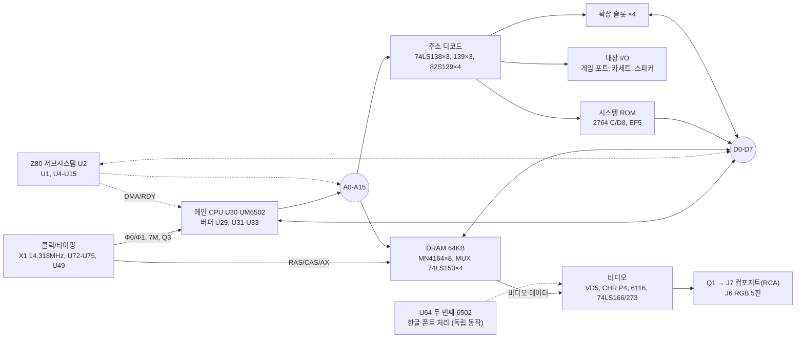

# 02. 시스템 구성

일반 Apple II와 달리 CPU가 세 개이고, 세 CPU가 각각 따로 동작합니다 (2026-11-06 측정 확인).

- U30 6502: 메인 CPU. Apple II 프로그램 실행
- U2 Z80: CP/M 실행
- U64 6502: 한글 폰트 처리를 독립적으로 담당. U30과 데이터 버스(D7 불통), Z80과 주소 버스를 공유하지 않고, 클럭도 U30과 다름

## 블록 다이어그램



점선은 결선 확인이 필요한 연결입니다. 인터랙티브 버전은 [`schematic/apple2-clone-schematic.html`](../schematic/apple2-clone-schematic.html)에 있습니다.

## 블록별 구성

| 블록 | 부품 | 내용 |
| --- | --- | --- |
| 메인 CPU | U30 UM6502(소켓), U29 74LS245, U31–U33 74LS367, R1 | 1.023MHz. 74LS367은 Apple II의 8T97 대체. U33 버퍼 하나는 CPU 박자(Φ0) 공급용 (아래 "측정으로 확인한 결선") |
| Z80 서브시스템 | U2 LH0080A, U1 74LS373, U4 74LS244, U5 82S123, U6–U7 74LS367, U8 74LS163, U9–U15 | CP/M 실행 (확인). 버스 공유 방식(SoftCard식 DMA 여부)은 미확인. U5가 Z80→6502 주소 변환 추정 |
| 두 번째 6502 | U64 UM6502 | 한글 폰트 처리 전용 CPU, 독립 동작 (확인). 비디오 블록과의 연결 경로는 미확인 |
| DRAM | U39–U42, U52–U55 MN4164, U43/44/56/57 74LS153 | 64KB. CPU/비디오 주소와 ROW/COL을 멀티플렉싱 |
| 시스템 ROM | U45 "C/D8", U46 "EF5", U63 74LS245 | C000–FFFF 16KB (라벨 기준 추정) |
| 비디오 | U65 "VD5", U70 "CHR P4", U68 HM6116, U66 74LS374, U67 74LS245, U69 74LS273, U71 74LS166, U82 74LS393, U85 74S153, 74LS157/257 다수 | VD5는 U64 데이터 버스에 연결됨(U64용 프로그램 또는 한글 폰트 ROM, 2026-11-06 확인). CHR P4 = 한글/80컬럼 추정. 6116은 화면 버퍼 또는 폰트 RAM 추정. 출력은 컴포지트(J7, 케이스 표기 VIDEO, Q1 버퍼)와 **RGB 5핀(J6, 케이스 표기 RGB)** 두 가지 |
| 클럭/타이밍 | X1 + 트리머 콘덴서, U72 74LS04, U73/U49 74LS175, U75 74LS195, U76 74LS109, U74 74LS08, U60/U61/U62/U78 | 14.31818MHz(추정)에서 7M, 3.58M, Q3, Φ0/Φ1, RAS/CAS 생성 |
| 주소 디코드 | U21/U35/U77 74LS139, U22–U24 74LS138, U34 74LS00, U48 74LS02, U36/U38/U50/U51 82S129, U25 74LS259 | ROM CS, C0xx 내부 I/O, I/O SELECT, DEVICE SELECT |
| 내장 I/O | U27 NE558, U28 74LS251, U3 LM339, U26 74LS74, Q2, J4/J5/J8/J9 | 게임 포트(Apple II H13/H14 상당), 카세트(3.5mm 잭 ×2, 케이스 표기 CASSETTE), 스피커(J8, Q2 구동) |
| 확장 | SL1–SL4, U16 74LS323, U17/U18 PROM, U19 74LS174, U20 74LS259 | 보조 로직 역할 미확인 (언어카드 또는 프린터 I/F 추정) |
| 전원 | J1 5핀 | +5V, GND, ±12V, −5V 추정 |

## 측정으로 확인한 결선 (2026-11-07 수리 중)

자세한 측정값은 [`08-repair-log.md`](08-repair-log.md), 핀 단위 기록은 [`data/netlist.csv`](../data/netlist.csv).

### 박자(Φ0) 배선: CPU용과 슬롯용이 따로

원래 Apple II는 CPU 핀 37과 슬롯 핀 40이 같은 선이지만, 이 보드는 **CPU 박자를 별도 버퍼로 따로 공급**합니다.

```
(타이밍 회로, 출처 미확인) → U33 74LS367 핀 4 → 핀 5 ──┬─→ U30 핀 37 (Φ0 입력)
                                                       └─ R1 1kΩ → GND (풀다운)

(타이밍 회로) → 슬롯 1–4 핀 40 (Φ0) ── U78 74LS74 핀 1(/CLR1), U1 74LS373 핀 11(LE)
```

- U33 핀 1(/G1) ≈ 0.17V → 버퍼 켜짐. U33 핀 4·5, U30 핀 37 모두 약 1MHz (테스터)
- U30 핀 37 ↔ 슬롯 핀 40은 도통되지 않는 것이 정상 구조
- U30 핀 37 경로: 뒷면 선 → 핀 3·4 사이 → 비아 → 앞면 → R1 신호쪽 다리 → 앞면 선 다발 → U33 핀 5

### 칩 방향 (앞면, 슬롯이 위쪽)

- 가로로 놓인 칩(U30, U64, U72 등): 노치 왼쪽, **1번 핀 = 왼쪽 아래**
- 세로로 놓인 칩(U31–U37, U74–U78, U49, U1 등): 글자가 아래→위로 읽히고 노치가 아래쪽, **1번 핀 = 오른쪽 아래**. 오른쪽 줄 아래→위로 1, 2, 3…, 왼쪽 줄 위→아래로 이어짐 (U1 핀 11, U31–U34 노치로 확인)

### 슬롯 방향

- 슬롯 1 = 앞면 왼쪽 끝. 각 슬롯 **왼쪽 줄 = 26(위)–50(아래), 오른쪽 줄 = 25(위)–1(아래)**. 핀 50 = +12V로 네 슬롯 모두 확인
- 뒷면은 좌우 반전: 슬롯 1이 오른쪽 끝(J1 바로 왼쪽), 오른쪽 줄이 26–50

### 앞면·뒷면 사진 좌표

앞면 기준 사진(202813)과 뒷면 기준 사진(203240)을 비아 205개로 맞췄습니다 (평균 오차 약 2px). 뒷면을 앞면 좌표로 바꾼 사진: [`analysis/back_on_front.jpg`](../analysis/back_on_front.jpg). 변환: [`data/front_back_registration.json`](../data/front_back_registration.json), 도구: [`tools/register_front_back.py`](../tools/register_front_back.py).

### 제조사와 부팅 화면

부팅하면 "ZW" 글자로 그린 큰 **HART** 로고와 **"Zung Won Co.,Ltd. 542-3675 SEOUL KOREA"** 문구가 나옵니다 ([사진](../photos/screen/20261107_015041_boot-logo_vertical-roll.jpg)). 제조사는 서울의 Zung Won Co., Ltd.로 보입니다.

## Apple II 레퍼런스와의 대응

| 기능 | Apple II 원본 | 이 보드 |
| --- | --- | --- |
| 주소 버퍼 | 8T97 ×3 | 74LS367 ×3 |
| 비디오 카운터 | 74LS161 ×4 | 74LS393 |
| 소프트스위치 | F14 74LS259 | U25 74LS259 |
| 패들 타이머 | H13 558 | U27 NE558 |
| 게임 입력 MUX | H14 74LS251 | U28 74LS251 |
| 카세트 입력 | K13 741 | U3 LM339 |
| DRAM | 4116 ×24 (48KB, +12V/−5V 필요) | 4164 ×8 (64KB, +5V 단일) |
| ROM | 2316 ×6 | 2764 ×2 |
