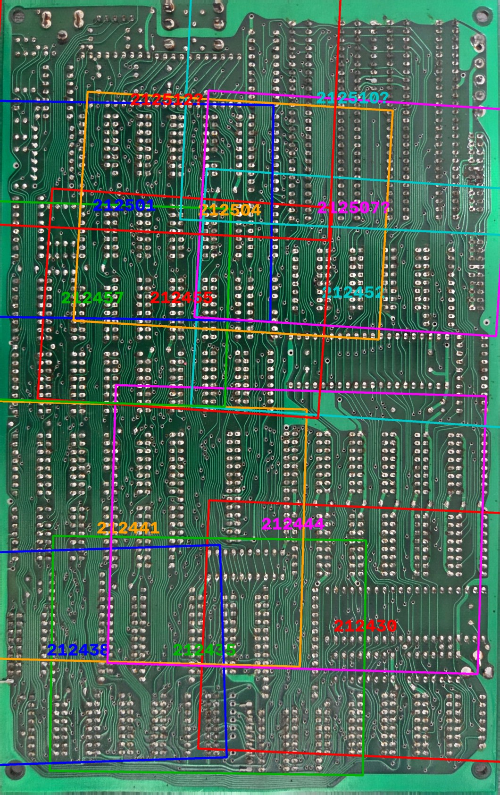
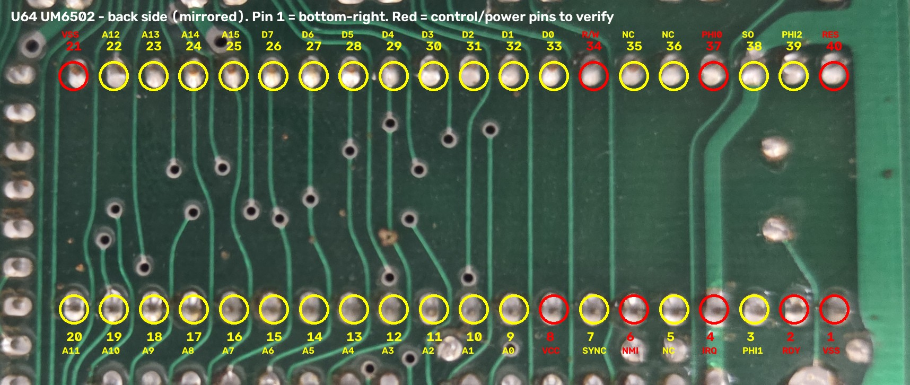
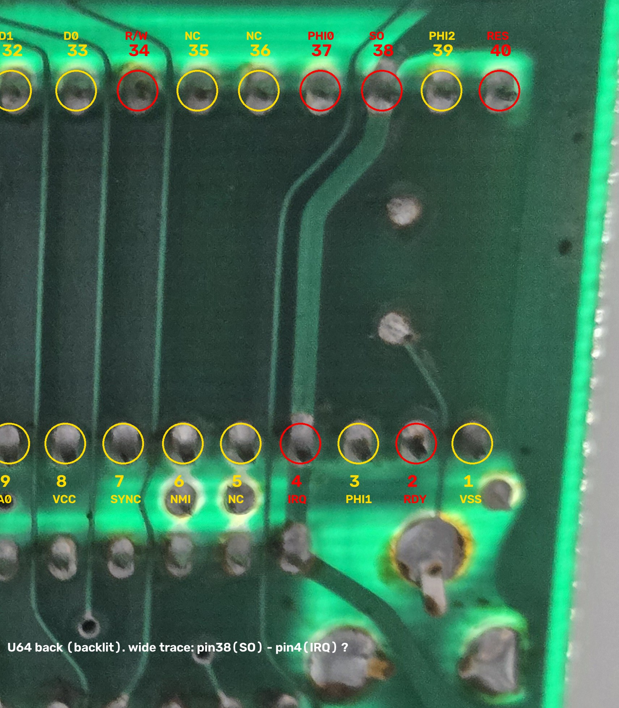

# 07. 뒷면 패턴 추적 노트

뒷면 확대 사진 13장을 뒷면 기준 스캔(`photos/overview/back/203240_back-flat_registration-ref.jpg`)에 정합해 위치와 회전을 계산했습니다.
이제 확대 사진 어느 위치든 스캔 좌표로 바꿀 수 있고, 스캔 좌표는 앞면 배치도와 좌우 반전 관계이므로 칩 위치를 확대 사진에 겹쳐 볼 수 있습니다.

## 정합 결과

| 사진 | 일치 특징점 | 신뢰도 | 대략 위치 (뒷면 기준) |
| --- | --- | --- | --- |
| 212501 | 110 | 높음 | 위쪽, 왼쪽 |
| 212504 | 56 | 높음 | 위쪽, 가운데 |
| 212507 | 30 | 낮음 | 위쪽, 오른쪽 |
| 212510 | 21 | 낮음 | 맨 위, 오른쪽 |
| 212512 | 20 | 낮음 | 맨 위, 왼쪽 |
| 212452 | 94 | 높음 | 가운데 위, 오른쪽 |
| 212455 | 113 | 높음 | 가운데 위, 가운데 |
| 212457 | 119 | 높음 | 가운데 위, 왼쪽 |
| 212441 | 124 | 높음 | 아래쪽, 왼쪽~가운데 |
| 212444 | 58 | 높음 | 아래쪽, 가운데~오른쪽 |
| 212430 | 63 | 높음 | 아래쪽, 오른쪽 (U64 포함) |
| 212435 | 71 | 높음 | 맨 아래, 가운데 |
| 212438 | 48 | 높음 | 맨 아래, 왼쪽 |

- 변환 행렬: [`data/back_zoom_registration.json`](../data/back_zoom_registration.json)
- 재현 스크립트: [`tools/register_back_zoom.py`](../tools/register_back_zoom.py), [`tools/warp_to_scan.py`](../tools/warp_to_scan.py)
- 신뢰도 "낮음" 3장은 반복되는 패드 무늬 때문에 일치점이 적습니다. 위치를 눈으로 다시 확인해야 합니다.
- **빠진 구역**: 뒷면 맨 위 띠(잭·RCA 납땜부), 왼쪽 가장자리 세로 띠, 가운데(y≈1550–1700) 일부, 오른쪽 아래 모서리.

## 좌표 관계

- 앞면 배치도 격자(1000×1600)와 뒷면 스캔(2121×3369) 사이: `back_x ≈ (1 − fx/1000) × 2121`, `back_y ≈ fy/1600 × 3369`
- 확인: 메인 6502(U30)의 계산 위치와 스캔 위 40핀 패턴 위치가 일치

## CPU 역할 확정 (2026-11-06)

측정으로 세 CPU가 **각각 따로 동작**하는 것을 확인했습니다. 같은 버스에 병렬로 묶이거나 리셋으로 멈춰 둔 구조가 아닙니다.

| CPU | 역할 |
| --- | --- |
| U30 UM6502 | 메인 CPU. Apple II 프로그램 실행 |
| U2 Z80A (LH0080A) | CP/M 실행 |
| U64 UM6502 | 한글 폰트 처리를 독립적으로 담당 |

근거가 된 측정 ([`data/netlist.csv`](../data/netlist.csv)):

| 측정 | 결과 | 의미 |
| --- | --- | --- |
| U30 핀 26 ↔ U64 핀 26 (D7) | 불통 | U64는 메인 6502와 데이터 버스를 공유하지 않음 |
| U2(Z80) 주소선 ↔ U64 주소선 | 불통 | U64는 Z80과도 주소 버스를 공유하지 않음 |
| U30 클럭 ↔ U64 클럭 | 서로 다름 | U64는 별도 클럭으로 동작 |

따라서 U64는 자기 주소·데이터 버스와 클럭을 따로 가진 독립 서브시스템입니다.

| U64 핀 33 (D0) ↔ U65 "VD5" 핀 11 (D0) | 도통 | U65가 U64 데이터 버스에 연결됨 |
| U64 핀 9 (A0) ↔ U65 핀 10 (A0) | 불통 | U65 주소는 U64 A0에 직결되지 않음 |
| U64 핀 33 (D0) ↔ U70 "CHR P4" 핀 11 (D0) | 불통 | U70은 U64 D0에 직결되지 않음 |
| U64 핀 33 (D0) ↔ U68 6116 핀 9 (D0) | 불통 | U68은 U64 D0에 직결되지 않음 |
| U64 핀 33 (D0) ↔ U67 74LS245 핀 3 (A2) | 도통 | U64 데이터 버스가 U67 버퍼의 A쪽에 연결됨 |
| U64 핀 33 (D0) ↔ U67 나머지 데이터 핀 | 불통 | |

| U30 핀 40 (RES) ↔ U64 핀 40 (RES) | 약 2kΩ | 직결도 분리도 아님. 아래 해석 참고 |

RES 2kΩ 해석 (추정): 두 CPU가 각자 +5V 풀업 저항을 갖고 있으면, 두 핀 사이를 재면 "풀업1 + 풀업2"가 +5V 선을 통해 직렬로 잡힙니다(예: 1kΩ + 1kΩ). 그렇다면 리셋은 서로 다른 회로에서 오는 것입니다. 또는 두 RES 사이에 2kΩ 저항 하나가 직렬로 들어 있을 수도 있습니다. U30 핀 40 ↔ +5V, U64 핀 40 ↔ +5V를 각각 재서 합이 2kΩ 근처인지 보면 구분됩니다.

U67은 U64 데이터 버스와 다른 곳(B쪽) 사이의 양방향 버퍼입니다. U64 D0가 U67의 2번째 비트(A2)에 들어가므로 **이 보드는 데이터선 순서를 바꿔 배선**했습니다. 그래서 핀 번호가 같은 신호끼리만 재면 연결을 놓칠 수 있습니다. U65 A0가 불통이었던 것도 같은 이유일 가능성이 큽니다.

해석 (추정):
- U65는 데이터선은 U64에 직결되지만 A0는 아닙니다. 가능성은 두 가지입니다. ① 배선 편의로 주소선 순서를 바꿔 연결함(U64 A0가 U65의 다른 주소 핀에 연결). ② U65 주소가 74LS157/257 MUX나 래치를 거쳐 들어옴(U64 주소와 비디오 카운터 주소를 번갈아 받는 구조).
- U70·U68의 D0가 U64 D0에 직결되지 않는다고 해서 U64와 무관하다고 단정할 수는 없습니다. 데이터선 순서를 바꿨거나 U67 74LS245 같은 버퍼를 거칠 수 있습니다.

U65 "VD5"는 그동안 40컬럼 문자 ROM으로 추정했지만, U64 데이터 버스에 붙어 있으므로 **U64가 읽는 ROM**입니다. U64의 프로그램 ROM이거나 한글 폰트 ROM일 가능성이 높습니다. 덤프하면 바로 구분됩니다(6502 코드라면 끝부분 $1FFA–$1FFF에 리셋·인터럽트 벡터가 있음).

- 아래 "U64 뒷면 핀 배치"에서 주소·데이터 핀 배선이 "메인 CPU 방향"으로 간다고 적은 것은 방향만 본 것입니다. 실제로는 U30 버스와 연결되지 않으므로, U64 자체 버스로 다시 추적해야 합니다.
- 아래 "역광 사진 분석"의 추정(리셋이 고정된 예비 CPU)은 **틀린 것으로 판명**되었습니다. 기록을 위해 남겨 둡니다.
- Z80 주소선과 클럭 비교는 어느 핀을 쟀는지와 주파수 값이 기록되지 않았습니다. 다시 재게 되면 netlist에 핀 단위로 추가합니다.

### U64 서브시스템 다음 확인 대상

1. U64 주소·데이터 버스에 붙은 ROM/RAM 찾기. **U65 "VD5" 데이터선 연결 확인** (D0 도통, A0 불통). U70·U68은 D0 직결 아님
    - U64 핀 9(A0)를 U65 주소 핀 전체(2–10, 21, 23, 24, 25)에 대 보기 → 주소선 순서 바꿈 여부
    - U64 핀 9를 근처 74LS157/257 입력 핀에 대 보기 → MUX 경유 여부
    - ~~U64 핀 33(D0)을 U67 74LS245 핀 2–9, 11–18에 대 보기~~ → 핀 3(A2) 도통 확인
    - U67 핀 17(B2, 핀 3의 반대편)을 U68 6116 데이터 핀(9–11, 13–17)과 U30 데이터 핀(26–33)에 대 보기 → 버퍼 너머에 무엇이 있는지
    - U67 핀 1(DIR)·19(/G)이 어느 칩에서 오는지 → 버퍼를 누가 여닫는지
2. U64 클럭 출처: 핀 37(Φ0 입력)이 타이밍 블록(U72–U76)의 어느 출력에 연결되는지, 주파수는 얼마인지
3. U30과 데이터를 주고받는 경로: 래치(U66 74LS374, U69 74LS273 등)나 공유 RAM을 거치는지

## U64 (두 번째 6502) 뒷면 핀 배치

앞면에서 U64는 노치가 왼쪽(트리머 콘덴서 쪽)이고 1번 핀이 왼쪽 아래입니다. 앞면 확대 사진 212258에서 노치 위치를 확인했습니다. 뒷면에서는 좌우가 바뀌어 **1번 핀이 아래 줄 오른쪽 끝**입니다. 패드 간격 2.54mm, 줄 간격 15.24mm(600mil)로 정합 결과와 맞습니다.

관찰 결과:

| 핀 | 신호 | 뒷면 패턴 |
| --- | --- | --- |
| 9–20 | A0–A11 | 있음. 북쪽(DRAM 사이 → 메인 CPU 방향)으로 다발을 이뤄 진행. 단, U30 버스와는 연결되지 않음 (2026-11-06 측정) |
| 22–33 | A12–A15, D7–D0 | 대부분 있음. 비아로 내려가거나 북쪽으로 진행 |
| 1, 2, 4, 6, 8 | VSS, RDY, IRQ, NMI, VCC | 뒷면 패턴 없음 (오른쪽 넓은 동박 영역 경계 근처) |
| 34–40 | R/W, NC, Φ0, SO, Φ2, RES | 뒷면 패턴 없음 → 앞면(칩 아래)으로 배선 |

**결론**: U64는 주소/데이터 핀이 실제로 배선된 소켓이므로 빈 예비 자리는 아닙니다. 다만 제어 핀(RDY, Φ0, R/W, RES 등)이 모두 앞면으로 가서 어디에 연결되는지는 사진으로 알 수 없습니다. 이 핀들을 테스터로 재야 U64의 역할을 판정할 수 있습니다.

## U64 우선 측정 목록

| U64 핀 | 신호 | 확인할 대상 |
| --- | --- | --- |
| 37 | Φ0 입력 | U30 핀 37과 같은 넷인지, 타이밍 블록의 다른 출력인지 |
| 40 | RES | U30 핀 40, 슬롯 핀 31과 같은 넷인지 |
| 2 | RDY | 슬롯 핀 21, U30 핀 2와 같은 넷인지 (다르면 별도 제어) |
| 34 | R/W | U30 핀 34, 슬롯 핀 18과 같은 넷인지 |
| 9 / 26 | A0 / D7 | U30 핀 9 / 26과 직접 연결인지, 버퍼(74LS245/367)를 거치는지 |
| 8 / 1 | VCC / VSS | 전원이 실제로 공급되는지 |

모두 U30과 같은 넷이면 두 6502가 같은 버스에 병렬로 묶인 구조(한쪽을 RDY 등으로 멈추는 방식)이고, 별도 넷이면 독립 서브시스템입니다.

## 다음 추적 대상

1. Z80(U2) 주변: 212510, 212512 구역. 정합 신뢰도가 낮아 위치를 다시 맞춘 뒤 진행
2. 게임 포트 J9 → U27(NE558), U28(74LS251): 뒷면 배선 위주라 사진 추적에 적합
3. 비디오 출력 J7 → U85(74S153) → 트랜지스터

## 역광 사진 분석 (2026-11-05 23:25 촬영)

역광 사진에서는 양면의 구리가 그림자로 겹쳐 보입니다. U64와 U30을 같은 조건에서 비교했습니다.

| 항목 | U30 (메인 6502) | U64 (두 번째 6502) |
| --- | --- | --- |
| 칩 아래 배선 | 거의 모든 핀에 가는 배선이 보임 | 데이터·주소 핀 일부만 배선이 보임 |
| 제어 핀 34–40, 1–3 | 배선 있음 | **어느 면에도 별도 배선이 보이지 않음.** 칩 아래 앞면이 넓은 동박으로 덮인 영역 안에 있음 |
| 굵은 배선 | - | 핀 38(SO)과 핀 4(IRQ)를 지나 아래 74LS04 쪽으로 내려가는 굵은 선. 전원(+5V) 레일로 추정 |

**해석 (추정, 2026-11-06 측정으로 기각됨. U64는 독립 동작하는 한글 폰트 처리 CPU)**
- U64의 제어 핀(RES·RDY·Φ0·R/W 등)은 신호선으로 구동되지 않고 앞면 동박(GND 또는 +5V 면)에 바로 붙어 있을 가능성이 높습니다.
- RES(40)가 GND 면에 붙어 있다면 U64는 **항상 리셋 상태로 묶인 예비 CPU**이고, 실제 동작에는 쓰이지 않습니다. 주소·데이터 핀이 버스에 연결되어 있는 것과도 모순되지 않습니다(리셋 중에는 버스를 구동하지 않음).
- SO·IRQ가 +5V에 묶여 있다면 인터럽트를 받지 않는 구조이고, 이 역시 "쓰지 않는 CPU"라는 해석과 맞습니다.

**확정 측정 (전원 끄고 저항 측정)**

| 측정 | 결과가 0Ω이면 |
| --- | --- |
| U64 핀 40 ↔ GND(U64 핀 1) | 리셋 고정 → 예비 CPU 확정 |
| U64 핀 40 ↔ U30 핀 40 | 리셋 공유 → 병렬 동작 구조 |
| U64 핀 4·38 ↔ +5V(U64 핀 8) | IRQ·SO를 +5V에 고정 |
| U64 핀 37 ↔ U30 핀 37 | 같은 클럭 사용 |
| U64 핀 2 ↔ GND | RDY 고정(정지) |

### 역광 전체 훑기 (23:39–23:40)

뒷면 전체를 역광으로 찍은 12장(`photos/backlit/sweep/`)도 확인했습니다. 배율이 낮아(핀 간격 약 16픽셀) 핀 단위 판독은 앞의 U64 접사(232515)가 더 낫습니다. U64 쪽(234045)에서도 수정 발진자에 가까운 제어 핀 쪽 끝에는 별도 배선이 보이지 않아, 위 해석과 같은 결과입니다.
