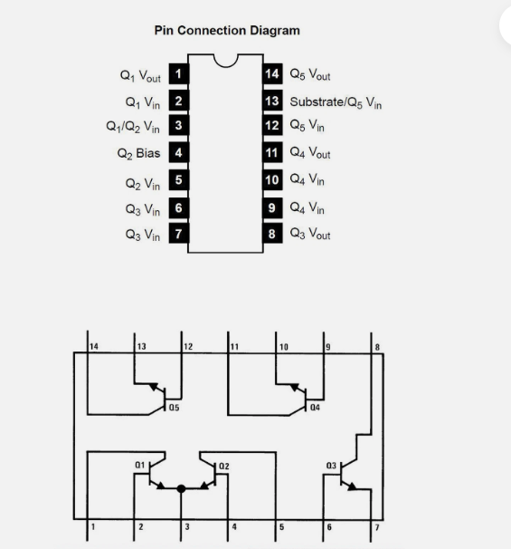

# 디스크 드라이브: 금성통신 GFD-450A1

HART에 딸린 5¼" 디스크 드라이브를 분해해 기판·모터를 찍은 사진(2026-11-19, 37장, [`photos/fdd/`](../photos/fdd/))으로 정리한 내용입니다. 사진 판독이라 측정으로 확인한 것은 없습니다.

## 정체

| 항목 | 내용 | 근거 |
| --- | --- | --- |
| 모델 | **GFD-450A1**, 금성통신(GoldStar Tele-Electric Co., Ltd.) | 헤드 레일 위 명판 (201337, Scan_201305) |
| 기판 | S33238-Q2152-X1 1-X501, 손글씨 "A009" | 실크 (201229) |
| 시기 | 칩 날짜 8333–8407 (1983–84년) | IC1 8407, IC3 8333, IC4 8406. HART 본체 칩(8404–8509)과 같은 시기 |
| 방식 | **Apple Disk II 호환 드라이브** (컨트롤러는 본체 U16–U20) | 20핀 단자, 읽기 증폭기 MC3470, 74LS125, ULN2003A = Disk II 드라이브 아날로그 기판과 같은 구성 |

웹에서 GFD-450A1 자료는 찾지 못했습니다 (2026-11-19 검색).

## 기판 부품

| 부품 | 표기 | 역할 (추정 포함) |
| --- | --- | --- |
| J1 | 2×10 핀, 리본 케이블 | Disk II 20핀 인터페이스. 실크 "10"·"20"이 한쪽 끝에 있음 |
| IC1 | ULN2003A 8407 | 헤드 스테퍼 모터 4상 구동 → J4(6핀) (추정) |
| IC2 | TI SN74LS125AN J401B | 3상태 버퍼 (드라이브 인에이블에 따라 신호 입출력, 추정) |
| IC3 | "ULN2046A" 8333 (로고 흐림) | 범용 소신호 NPN 트랜지스터 5개 어레이, CA3046 호환 (아래 "IC3 ULN2046A"). R10–R14와 함께 헤드 쓰기 구동 (추정) |
| IC4 | Motorola MC3470AP L8406 | 플로피 읽기 증폭기. 헤드 신호 → 읽기 펄스. 주변 L·C 필터, T1·T2·T3 측정 핀, VR1 |
| FS480504 (C44Z JAPAN) + J5 + Q2 | 하이브리드 모듈 | 스핀들 모터 구동·속도 제어 (추정) |
| Q1 | TIP32C (PNP) | 전원부. C1·C5 220µF/16V (모터 전원 공급 추정) |
| RA1 | 저항 어레이 | 입력선 풀업 (추정) |
| J2(2핀)·J3(2×3)·J4(6핀) | 핀 헤더가 **기판 반대쪽(섀시 쪽)** 으로 나 있고 **케이블 커넥터가 꽂혀 있음** (205317·205323). 위에서 찍은 사진에는 납땜만 보여 처음에 "점퍼 없음"으로 잘못 봄 | J4 = 6칸 하우징에 5가닥(빨강·파랑·검정·흰·노랑 등) → 스테퍼 또는 보조 기판 쪽 (추정). J2·J3 = 센서(트랙 0·인덱스·쓰기 보호)나 모터 쪽 배선 후보, 미확인. J3 커넥터 하우징에 각인 "B00P?" (흐림) |
| 앞면 LED | 빨강 | 사용 중 표시 |

## IC3 ULN2046A: 핀 배치와 내부 구조

**정체**: ULN2046A는 Sprague(현 Allegro)가 만든 **RCA CA3046 호환품**입니다. Allegro 상호 대체표에 "CA3046(RCA) ≈ ULN2046A"로 올라 있고(기능 호환으로 표기), Radiomuseum의 CA3046 항목도 ULN2046(A)(Sprague)를 같은 계열로 적습니다. 그래서 핀 배치·사양은 **Intersil CA3046 데이터시트**(May 2001, File Number 341.5)를 기준으로 적었습니다. ULN2046A 자체 데이터시트는 찾지 못했습니다 (2026-11-21 검색).

출처
- Intersil CA3046 데이터시트: <https://www.eg.bucknell.edu/~dkelley/eceg351/lab/DataSheet_CA3046.pdf>
- eBay 판매 글 [301608272501](https://www.ebay.com/itm/301608272501) (Atlantic Electro). 설명 문구가 CA3046 데이터시트와 같음. 상품 사진 속 핀 배치도 사본: [`analysis/uln2046a_pinout.png`](../analysis/uln2046a_pinout.png)

### 구조

- **범용 실리콘 NPN 트랜지스터 5개**(Q1–Q5)를 한 기판(substrate)에 만든 **14핀 DIP**.
- **Q1·Q2는 이미터가 안에서 이어진 차동쌍** (3번 핀 공통). Q3·Q4는 따로 쓰는 트랜지스터.
- **Q5의 이미터는 기판과 함께 13번 핀**으로 나옴. 각 트랜지스터의 컬렉터는 기판과 다이오드 접합으로 분리되어 있어서, 데이터시트는 "13번(기판)을 회로에서 **가장 낮은 전위**에 연결해야 트랜지스터끼리 분리되고 정상 동작한다"고 적음. 따라서 실제 회로에서 13번은 GND(또는 가장 낮은 전원)이고 Q5는 이미터 접지로만 쓸 수 있음.
- 같은 칩 위라 트랜지스터끼리 전기·온도 특성이 잘 맞음.

### 핀 배치 (CA3046 데이터시트, 위에서 본 그림)

| 핀 | 단자 | 핀 | 단자 |
| --- | --- | --- | --- |
| 1 | Q1 컬렉터 | 14 | Q5 컬렉터 |
| 2 | Q1 베이스 | 13 | Q5 이미터 + **기판(substrate)** |
| 3 | Q1·Q2 이미터 (공통) | 12 | Q5 베이스 |
| 4 | Q2 베이스 | 11 | Q4 컬렉터 |
| 5 | Q2 컬렉터 | 10 | Q4 이미터 |
| 6 | Q3 베이스 | 9 | Q4 베이스 |
| 7 | Q3 이미터 | 8 | Q3 컬렉터 |

eBay 사진의 "Vin/Vout/Bias"는 판매자가 붙인 이름이라 단자 이름과 맞지 않습니다(예: 5번 "Q2 Vin"은 실제로 Q2 컬렉터, 7번 "Q3 Vin"은 Q3 이미터). 단자는 위 표를 따릅니다.

### 주요 사양 (CA3046, 25°C)

| 항목 | 값 |
| --- | --- |
| VCEO / VCBO / VEBO | 15V / 20V / 5V (최대) |
| 컬렉터–기판 전압 VCIO | 20V (최대) |
| 컬렉터 전류 IC | **50mA** (최대) |
| 소비 전력 | 트랜지스터 하나당 300mW (최대) |
| hFE | 100 (대표, IC = 1mA·10mA), 최소 40 (IC = 1mA) |
| VBE | 0.715V (IE = 1mA), 0.800V (IE = 10mA), 대표값 |
| 차동쌍 VBE 차이 | 0.45mV 대표, 최대 5mV |
| 차동쌍 입력 오프셋 전류 | 0.3µA 대표, 최대 2µA (IC = 1mA) |
| VCE(sat) | 0.23V (IB = 1mA, IC = 10mA) |
| fT | 최소 300MHz, 대표 550MHz (VCE = 3V, IC = 3mA) |
| 잡음 지수 | 3.25dB 대표 (1kHz, IC = 100µA, Rs = 1kΩ) |

### 이 드라이브에서의 의미

- 이름이 ULN2003A(IC1)와 비슷하지만 **전류를 세게 흘리는 드라이버가 아니라 소신호 트랜지스터 어레이**(최대 50mA, 15V)입니다. 모터 구동용은 아니고, 헤드 쓰기 전류(수 mA) 스위칭이나 차동 신호 처리 자리로 봅니다 (추정).
- Q1·Q2 차동쌍이 있으므로 R10–R14와 함께 **헤드 쓰기 전류를 헤드 코일 양쪽으로 번갈아 보내는 차동 스위치**일 가능성이 큼 (추정, 배선 확인 필요).
- 확인 방법: 기판에서 13번이 GND인지(데이터시트대로라면 GND), 3번(공통 이미터)이 저항을 거쳐 GND로 가는지(정전류원), 1·5번(컬렉터)이 헤드 쪽 커넥터로 가는지 따라가 보기.
- 교체가 필요하면 CA3046·LM3046 계열(14핀 DIP)이 같은 핀 배치입니다 (Allegro 표기상 기능 호환).

## 메커니즘 부품과 보조 기판 (2026-11-19 추가 3장)

| 부품 | 표기 | 내용 |
| --- | --- | --- |
| 헤드 스테퍼 모터 | **Sankyo Seiki MSHF200B31**, DC 12V, No. 4215, Japan | 헤드를 트랙 사이로 옮기는 모터. 여러 색 선 묶음이 나옴 (204120) |
| 스핀들 모터 | **Japan Servo DDF5-22F-39A**, DC 12V 0.79A max, **300RPM**, 손글씨 "DC21" | 디스크를 직접 돌리는 다이렉트 드라이브 모터. 300RPM은 Disk II·일반 5¼" 드라이브 모두 같음 (204307) |
| **보조 기판** (섀시 옆면에 나사 고정, 동그란 "3" 스티커) | IC1 TI **SN74LS32N** (432AJ, Malaysia) · IC2 **SN74LS175N** (8331) · IC3 **74LS86** · 금속 캔 부품 1개(트랜지스터로 보임, 표기 안 보임) · R1·R2 · C1–C4 | 아래 설명 (204123) |

### 보조 기판 = 스테퍼 신호 변환기 (추정)

- 선 10가닥이 한 줄로 들어옴: **"O" 쪽 4가닥(노랑·흰·파랑·빨강)**, 가운데 **검정·초록 2가닥**, **"I" 쪽 4가닥(노랑·흰·파랑·빨강)**. 같은 색 4가닥이 입력(I)·출력(O)으로 짝을 이루고 가운데 2가닥은 전원(GND·+5V)으로 보임.
- 칩이 OR(74LS32)·4비트 래치(74LS175)·XOR(74LS86)뿐이라 신호를 세게 구동하는 칩은 없음 → 4가닥 **논리 신호를 받아 4가닥 논리 신호로 바꿔 내보내는 기판**. 4가닥 = Disk II 헤드 위상 4개(J1 2·4·6·8번)와 개수가 같음.
- 따라서 **Disk II 위상 신호 → (이 기판에서 변환) → 기판의 ULN2003A → J4 → Sankyo 스테퍼** 순서로 이어질 가능성이 큼 (추정, 선 따라가기로 확인 필요).
- 왜 필요한가 (추정): Apple Disk II 드라이브는 Apple 컨트롤러의 위상 신호로 스테퍼를 직접 돌림. 이 드라이브는 금성이 일본산 일반 메커니즘(Sankyo 스테퍼, Japan Servo 모터)을 쓰므로 위상 순서·걸음 크기가 Apple 방식과 달라 **위상 순서를 이 메커니즘에 맞게 바꿔 주는 변환기**가 들어간 것으로 보임. 래치(74LS175)는 이전 위상을 기억하고, XOR(74LS86)은 위상 변화 방향을 판정하는 데 흔히 쓰는 조합.
- 보조 기판이 따로 나사로 붙어 있고 본 기판과 선으로 이어져 있어 **나중에 덧붙인 것일 수도** 있음. 04 문서의 "SEEK TIME 개조 메모"와 관련 있는지는 미확인.

**624KB 판단에 주는 의미**: 변환기가 Apple 위상 2번을 메커니즘 1걸음으로 바꾸는지(48TPI 메커니즘) 1:1로 넘기는지(96TPI 메커니즘)에 따라 이 메커니즘의 트랙 간격이 갈림. 74LS175·74LS86 핀의 배선을 따라가거나, 위상 신호를 순서대로 넣으며 헤드 이동을 보면 확인됨. 다만 어느 쪽이든 **면 선택 신호가 없어 양면 624KB는 여전히 불가** (아래 표).

## 사진에서 본 것

- **탄 흔적·손상 없음.** 칩·납땜 정상으로 보임.
- C6 위 신호선 4가닥에 걸친 투명 덩어리, H1의 푸른 덩어리 = **접착제·케이블 고정** (사용자 확인, 2026-11-19). 부식 아님. R4 옆 고정 나사 둘레 얼룩도 접착제로 보임.
- **C4 자리가 비어 있음**: 실크 "C4"에 구멍 2개만 있고 투명 테이프로 덮여 있음. 대신 103(10nF) 세라믹이 기판 가장자리 패드와 섀시 고정 나사 사이에 기판 밖으로 납땜되어 있음 → 기판 GND와 섀시를 잇는 콘덴서를 옮겨 단 개조로 추정 (203046, 203100).
- **J1 한 열(핀 2개)이 납으로 이어져 있음**: 실크 "10"·"20" 기준으로 11·12번. Disk II 배치에서는 둘 다 +5V라 문제없음 (공장 처리 추정). 측정으로 확인 필요.
- 위쪽 220µF(C1) 겉 피복이 긁히고 갈라짐. 부풂·누액은 안 보임.

## 624KB는 이 드라이브로 되는가

결론 (추정): **이 드라이브로는 624KB가 안 됩니다.** 624KB는 별도 드라이브와 별도 인터페이스 카드가 필요한 구성으로 판단합니다.

광고(`photos/ad/hart2-640_…v2.jpg`)도 사양 표 밑에 **"624KB 대용량 디스크 드라이브 개발"** 이라고 따로 적혀 있습니다. 본체 사양("FDD I/F 내장")과 나란히 적은 것이 아니라 별도 제품으로 소개한 것입니다.

### 계산

Apple 방식 한 트랙 = 16섹터 × 256바이트 = 4KB (MFM 512바이트 × 8섹터도 4KB).

| 구성 | 용량 |
| --- | --- |
| Disk II 표준 (단면, 35트랙) | 35 × 4KB = **140KB** (DOS 3.3) |
| 단면 40트랙 | 160KB |
| 단면 80트랙 (96TPI) | 320KB |
| **양면 80트랙, 면마다 2트랙 예약** | 2 × 78 × 4KB = **624KB** |
| 양면 80트랙 전체 | 640KB |

624KB가 딱 떨어지는 조합은 **양면 · 80트랙(96TPI) · 트랙당 4KB · 면마다 2트랙(시스템용) 제외**입니다 (추정, 다른 조합도 가능하지만 2면·96TPI는 필수).

### 이 드라이브가 안 되는 이유

| 조건 | 624KB에 필요한 것 | GFD-450A1 |
| --- | --- | --- |
| 양면 | 헤드 2개 + **면 선택 신호** | Disk II 20핀에는 면 선택 선이 없음. 읽기 증폭기(MC3470)도 하나, 헤드 전환 회로 안 보임 → 단면 (추정) |
| 80트랙 | 96TPI 헤드·스테퍼 | 확인 못 함. 스테퍼(Sankyo MSHF200B31) 사양 자료 없음. 스테퍼 변환 기판의 배선을 따라가면 판단 가능 (위 "보조 기판") |
| 컨트롤러 | 양면·80트랙을 다루는 카드와 소프트웨어 | 본체 내장 U16–U20은 Disk II 컨트롤러 그대로 |

### 기존 기록과 맞춰 보기

[`04-open-questions.md`](04-open-questions.md)에 사용자 제공 자료로 "CP/M에서 **7번 슬롯 별도 카드 + 80트랙 96TPI 드라이브(TEAC 800K급, 실사용 약 760KB)**"가 있습니다. 광고의 "624KB 드라이브"는 이 계열(양면 96TPI 드라이브 + 슬롯 카드)의 초기판 또는 다른 포맷 값으로 추정합니다. 760KB와 624KB가 왜 다른지(포맷·섹터 수·예약 트랙 차이)는 디스켓이나 카드 자료가 있어야 확인됩니다.

### 확인 방법

촬영 위치 그림: [`analysis/fdd_track_pitch_shots.jpg`](../analysis/fdd_track_pitch_shots.jpg) (① 금색 나사 막대 + 자, ② 스테퍼 걸음 각도, ③ 보조 기판 뒷면, ④ 헤드 누름 팔 아래, ⑤ 라벨). 한 걸음 이동 = 나사 피치 × (걸음 각도 ÷ 360°), 48TPI = 0.529mm, 96TPI = 0.265mm.

1. **헤드 개수**: 헤드 누름 팔(검정 레버) 아래를 보고, 위쪽에도 헤드(케이블 달린 것)가 있는지, 아니면 펠트 누름 패드인지 확인 → 패드면 단면 확정.
2. **트랙 수**: 디스크를 넣고 헤드를 끝까지 보냈을 때 이동 거리. 또는 남은 디스켓(800KB 카드용)을 이 드라이브에서 읽어 보기 (96TPI 디스켓은 48TPI 드라이브에서 못 읽음).
3. **624KB/760KB 디스켓**: 남아 있는 디스켓을 플럭스 이미지(Greaseweazle·Applesauce 등)로 떠서 트랙 수·면 수·섹터 형식 확인.
4. ~~시스템 ROM "C/D8"·"EF5" 덤프에서 슬롯 7 카드 드라이버 흔적 찾기~~ → **덤프 분석 완료 (2026-11-23)**: 메인보드 시스템 ROM U45의 $C600이 내장 Disk II(140KB) 부트 ROM임이 확인되었고, $C700은 디스크 컨트롤러가 아닌 커스텀 I/O 루틴임이 확인되었습니다. 따라서 624KB/800KB 대용량 FDD는 메인보드 내장이 아니라 **7번 슬롯에 장착했던 별도 인터페이스 카드(전용 FDC 칩 탑재)**에서 구동되었음이 확실해졌습니다 ([`12-memory-map.md`](12-memory-map.md) 참고).

## 다시 연결하기 전 측정 (케이블을 뒤집어 꽂은 이력 있음)

- 드라이브 J1 전원 핀(9 −12V, 11·12 +5V, 13 +12V, Disk II 배치 가정)과 GND(1·3·5·7) 사이 저항: 0Ω 근처면 합선
- 11·12번이 이어진 것이 +5V인지 확인
- 핀 배치: [`05-interface-pinouts.md`](05-interface-pinouts.md) "FDD 단자 J2·J3"
