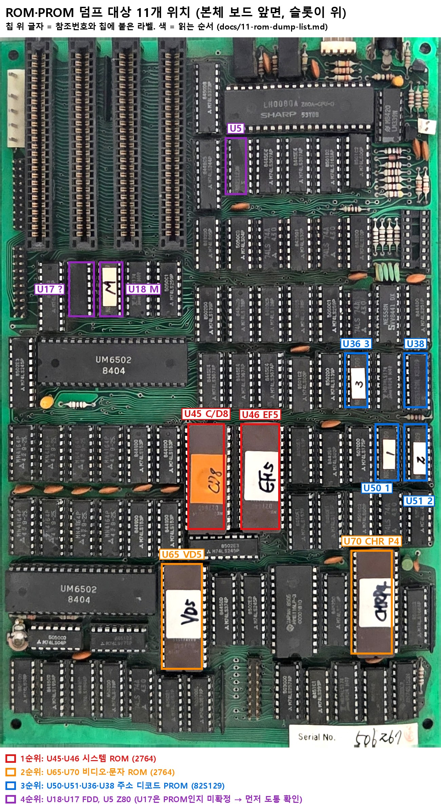

# ROM·PROM 덤프 목록 (본체 보드)

정원 HART 본체 보드에서 **칩을 뽑아 ROM 리더기로 읽을 대상**을 정리한 문서입니다. 칩 정보는 [`03-bom.md`](03-bom.md)·[`data/bom.csv`](../data/bom.csv) 기준이고, 같이 있는 FDD(GFD-450A1)·키보드(ZPC-40)에는 ROM이 없습니다 (기판 칩 표기 확인: FDD = MC3470·74LS125·ULN2003A·ULN2046A·74LS32/175/86, 키보드 = 74LS145·74LS03).

## 대상 요약

| 종류 | 개수 | 참조번호 |
| --- | --- | --- |
| 2764 EPROM (8KB, 28핀) | 4 | U45 "C/D8", U46 "EF5", U65 "VD5", U70 "CHR P4" |
| 82S129 계열 바이폴라 PROM (256×4, 16핀) | 5 | U18 "M", U36 "3", U38, U50 "1", U51 "2" |
| 82S123 바이폴라 PROM (32×8, 16핀) | 1 | U5 |
| 정체 미확인 16핀 (표기 갈림) | 1 | U17 |
| **합계** | **11** | |

### 보드 위 위치

앞면 기준 사진(202813)에 표시했습니다. 슬롯이 위로 가게 놓고 봅니다. 상자 색은 아래 "덤프 목록"의 순위와 같습니다 (빨강 1, 주황 2, 파랑 3, 보라 4). 칩 위치는 [`data/bom.csv`](../data/bom.csv) 좌표로 그렸습니다. 그림 생성: [`tools/annotate_rom_dump.py`](../tools/annotate_rom_dump.py).

## 덤프 목록

우선순위 1이 가장 먼저 읽을 칩입니다. "칩 표기"의 판정(확인/추정)은 03 문서와 같습니다.

| 순위 | 참조 | 라벨 | 칩 표기 | 블록 | 리더기 장치 선택 | 덤프로 알 수 있는 것 | 저장 파일명 (`rom/`) |
| --- | --- | --- | --- | --- | --- | --- | --- |
| 1 | **U45** | C/D8 | NEC D2764D (확인) | 시스템 ROM | 2764 (8KB) | 메인 CPU의 $C000–$DFFF 내용 (추정). 내장 FDD 부팅 코드($C600)·슬롯 번호, HART 로고, Z80 전환 | `U45_CD8.bin` |
| 1 | **U46** | EF5 | NEC D2764D (확인) | 시스템 ROM | 2764 | $E000–$FFFF: BASIC·모니터, 리셋 벡터 (추정). Apple II+ ROM과 비교 | `U46_EF5.bin` |
| 2 | **U65** | VD5 | NEC D2764D, 8448X1011 (판독 추정) | 비디오 / U64 쪽 | 2764 | U64(두 번째 6502) 데이터 버스에 연결됨 (D0 도통 확인). U64 프로그램인지 한글 폰트인지 — 끝부분 $1FFA–$1FFF에 6502 벡터가 있으면 프로그램 | `U65_VD5.bin` |
| 2 | **U70** | CHR P4 | 28핀 세라믹 창 EPROM, NEC D2764D 추정 | 비디오 / 문자 발생 | 2764 | 문자 발생 ROM. 비트맵으로 그려 보면 영문·한글·80컬럼 글꼴인지 바로 보임 | `U70_CHRP4.bin` |
| 3 | **U50** | 1 | N82S…509 (82S129 추정) | 주소 디코드 | 82S129 | 주소 맵 (ROM 선택·I/O 디코드). 안 켜질 때 뜨거웠던 칩 | `U50_1.bin` |
| 3 | **U51** | 2 | N82S…509 (82S129 추정) | 주소 디코드 | 82S129 | 주소 맵. U50과 같이 해석 | `U51_2.bin` |
| 3 | **U36** | 3 | N82S129N (추정) | 주소 디코드 | 82S129 | 주소 맵 | `U36_3.bin` |
| 3 | **U38** | (라벨 기록 없음) | N82S129N K8509 (확인) | 주소 디코드 | 82S129 | 주소 맵 | `U38.bin` |
| 4 | **U18** | M | N8…9 (82S129 추정) | 내장 FDD 컨트롤러 | 82S129 | FDD 순서 제어(Disk II의 P6 역할) 여부. Apple P6(341-0028)와 비교 | `U18_M.bin` |
| 4 | **U17** | (표기 갈림) | 16핀, 윗면 표기 없음 | 내장 FDD 컨트롤러 | 82S129로 시도 (미확정) | PROM인지부터 확인 필요 → 아래 "U17" | `U17_try82S129.bin` |
| 4 | **U5** | (라벨 기록 없음) | N82S123N (확인) | Z80 서브시스템 | 82S123 (32×8) | Z80 ↔ 6502 주소 변환 (추정). SoftCard 방식과 비교 | `U5_82S123.bin` |

### U17 (주의)

- 윗면을 갈아 표기가 없고, **PROM인지 아닌지 미확정**입니다 (사용자는 롬이 아니라고 봄, [`04-open-questions.md`](04-open-questions.md)).
- 뽑기 전에 먼저: 전원 끄고 **U17 ↔ U18 같은 번호 핀 1–7·15 도통**. 대부분 통하면 U18과 짝을 이룬 PROM일 가능성이 큼 → 82S129로 읽어 봄.
- 대부분 안 통하면 PROM이 아닐 수 있으므로 리더기로 읽지 말고 핀 배선부터 조사합니다 (논리 칩에 PROM 읽기 전압을 걸지 않도록).
- 칩을 뺐을 때 **밑면·옆면 표기**도 사진으로 남깁니다.

## 칩을 뽑지 않고 먼저 할 수 있는 것

U45·U46(시스템 ROM)은 메인 CPU가 직접 보므로, 칩을 뽑기 전에 [`tools/romdump.bas`](../tools/romdump.bas)로 화면 출력을 받아 둘 수 있습니다 (절차: [`06-next-steps.md`](06-next-steps.md) "ROM 덤프"). 리더기로 뽑은 결과와 비교하면 주소 배치(어느 칩이 어느 주소인지)가 확인됩니다. 나머지 9개는 메인 CPU에서 보이지 않아 리더기로만 읽을 수 있습니다.

## 뽑기 전·읽을 때 주의

1. **칩이 소켓에 꽂혀 있는지 먼저 확인**. 이 목록의 칩별 소켓 여부는 아직 정리되지 않았습니다. 기판에 직접 납땜된 칩은 뽑지 말고 따로 정합니다.
2. 뽑기 전에 **방향(노치) 사진**을 찍습니다. 이 보드는 가로 칩 1번 핀이 왼쪽 아래, 세로 칩 1번 핀이 오른쪽 아래입니다 (앞면, 슬롯 위쪽 기준, README "보드 요약").
3. **EPROM 창 위 라벨을 떼지 않습니다** (U70 "CHR P4"는 창이 보이는 세라믹 EPROM). 창이 빛에 오래 노출되면 내용이 지워질 수 있으니 라벨이 없으면 불투명 테이프로 덮습니다.
4. 리더기에서 **읽기(Read)만** 합니다. 지우기·쓰기·빈 칩 검사 같은 기능은 쓰지 않습니다.
5. 바이폴라 PROM(82S129·82S123)은 리더기의 장치 목록에 해당 품번이 있는지 먼저 확인합니다. 256×4(82S129)는 4비트 데이터라 파일 크기가 256바이트(상위 4비트 무시)입니다.
6. **같은 칩을 두 번 읽어 결과가 같은지** 비교합니다. 다르면 핀 접촉 불량입니다.
7. 리더기가 보여 주는 칩 ID·장치 이름을 기록합니다 (U70 정확한 품번 확인용).
8. 다 읽은 뒤 **원래 자리·원래 방향**으로 꽂고, 켜서 HART 로고 화면이 나오는지 확인합니다 (정상 기준: [`09-verified-baseline.md`](09-verified-baseline.md)).
9. 하루에 다 하지 않아도 됩니다. 순위 1 → 2 → 3 → 4 순서로 묶어서 하고, 묶음마다 다시 켜서 정상 동작을 확인하면 문제가 생겼을 때 원인을 좁히기 쉽습니다.

## 결과 기록 (덤프 후 채움)

| 참조 | 파일 | 크기 | SHA-1 | 리더기 장치명 | 두 번 읽기 일치 | 날짜 |
| --- | --- | --- | --- | --- | --- | --- |
| U45 | `rom/U45_CD8.bin` | | | | | |
| U46 | `rom/U46_EF5.bin` | | | | | |
| U65 | `rom/U65_VD5.bin` | | | | | |
| U70 | `rom/U70_CHRP4.bin` | | | | | |
| U50 | `rom/U50_1.bin` | | | | | |
| U51 | `rom/U51_2.bin` | | | | | |
| U36 | `rom/U36_3.bin` | | | | | |
| U38 | `rom/U38.bin` | | | | | |
| U18 | `rom/U18_M.bin` | | | | | |
| U17 | `rom/U17_try82S129.bin` | | | | | |
| U5 | `rom/U5_82S123.bin` | | | | | |
