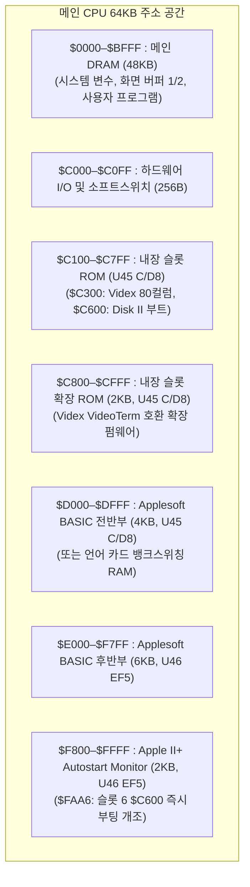

# 12. 메모리 맵 (Memory Map)

정원 HART 본체 보드의 메모리 구성과 주소 공간을 정리한 문서입니다. 본 기기는 일반 Apple II+와 달리 **CPU가 세 개(메인 6502, CP/M용 Z80, 비디오/기능키/한글용 6502)** 실장되어 있으며, 각각 독립된 주소 공간 및 주소 변환(디코딩) 체계를 가지고 있습니다.

2026-11-22~23 진행된 11개 ROM/PROM 덤프 분석을 통해 확인된 실제 메모리 배치와 동작을 기준으로 작성되었습니다. 전체 롬의 세부 역어셈블리 소스 및 테이블은 [**`disasm/` 디렉터리**](../disasm/README.md)에 보관되어 있습니다.

---

## 1. 개요: 3개 CPU의 메모리 공간

| 프로세서 | 버스 구성 | 사용 ROM / RAM | 주요 역할 및 특징 |
| :--- | :--- | :--- | :--- |
| **메인 CPU (U30 6502)** | 메인 시스템 버스 | DRAM 64KB (MN4164×8)<br/>ROM 16KB (U45, U46 2764×2) | Apple II+ 호환 환경 실행. 슬롯 및 내장 FDC($C600), 내장 80컬럼 Videx($C300/$C800), BASIC/모니터 실행 |
| **보조 CPU (U2 Z80A)** | 메인 버스 공유 (주소 변환) | 메인 DRAM 64KB 공유<br/>주소 변환 PROM (U5 82S123) | CP/M 2.2 실행. Microsoft SoftCard 호환 하드웨어 주소 변환을 통해 6502 주소 공간 접근 |
| **보조 CPU (U64 6502)** | 데이터·클럭·리셋이 분리된 로컬 버스. U68만 메인과 공유 (74LS157 MUX로 주소 전환) | 펌웨어 ROM 8KB (U65 "VD5")<br/>**공유** VRAM 2KB (U68 HM6116, 메인 `$E000–$E7FF`와 공유)<br/>문자 ROM 8KB (U70 "CHR P4") | 화면 하단 기능키(F1–F12) 바 표시, 80컬럼 화면 버퍼 관리, 한글 폰트 처리 등을 담당하는 독립 비디오 프로세서 |

---

## 2. 메인 CPU (U30 6502) 메모리 맵

메인 6502는 $0000–$FFFF의 64KB 전체 주소 공간을 아래와 같이 사용합니다.



### 2.1 전체 주소 요약 표

| 주소 범위 | 크기 | 장치/기능 | 실장 칩 | 설명 |
| :--- | :--- | :--- | :--- | :--- |
| **$0000–$00FF** | 256B | 제로 페이지 (Zero Page) | MN4164 DRAM | 6502 고속 시스템 포인터 및 인터프리터 변수 |
| **$0100–$01FF** | 256B | 시스템 스택 (Stack) | MN4164 DRAM | 하드웨어 스택 영역 |
| **$0200–$03FF** | 512B | 입력 버퍼 및 벡터 | MN4164 DRAM | 키보드 버퍼, 소프트/하드 리셋 벡터 ($03F2 등) |
| **$0400–$07FF** | 1KB | 텍스트 / Lo-Res 페이지 1 | MN4164 DRAM | 표준 40×24 화면 버퍼 (화면 출력 1) |
| **$0800–$0BFF** | 1KB | 텍스트 / Lo-Res 페이지 2 | MN4164 DRAM | 텍스트 화면 페이지 2 |
| **$0C00–$1FFF** | 5KB | 사용자 프로그램 RAM | MN4164 DRAM | BASIC 프로그램 / 데이터 영역 |
| **$2000–$3FFF** | 8KB | Hi-Res 그래픽 페이지 1 | MN4164 DRAM | 고해상도 그래픽 페이지 1 (280×192) |
| **$4000–$5FFF** | 8KB | Hi-Res 그래픽 페이지 2 | MN4164 DRAM | 고해상도 그래픽 페이지 2 (280×192) |
| **$6000–$BFFF** | 24KB | 사용자 프로그램 / DOS 영역 | MN4164 DRAM | ProDOS / DOS 3.3 로드 영역 (최대 RAM 탑재 시) |
| **$C000–$C0FF** | 256B | 하드웨어 I/O 및 소프트스위치 | 회로 로직 / FDC | I/O 레지스터, 키보드, 카세트, 스피커, FDC |
| **$C100–$C7FF** | 1.75KB | 내장 슬롯 ROM | **U45 (2764)** | 각 슬롯별 256B 펌웨어 ($C300 80컬럼, $C600 FDD) |
| **$C800–$CFFF** | 2KB | 슬롯 확장 공용 ROM | **U45 (2764)** | Videx 호환 80컬럼 확장 드라이버 펌웨어 |
| **$D000–$DFFF** | 4KB | Applesoft BASIC (전반부) | **U45 (2764)** | 기본 BASIC 롬 (또는 뱅크스위칭 16KB RAM) |
| **$E000–$F7FF** | 6KB | Applesoft BASIC (후반부) | **U46 (2764)** | 기본 BASIC 롬 인터프리터 루틴. 단 `$E000–$E7FF`는 80컬럼 펌웨어가 **U68(공유 화면 RAM)**으로 씀 — U51 O4 = 1(80컬럼 래치)일 때 `$E000–$EFFF` 창이 롬 대신 U68로 감 (U36 보정 덤프, [13](13-u64-interface.md) 3.2.1절). 롬 쪽은 U36이 U45·U46 /CE와 A12를 직접 골라 줌 |
| **$F800–$FFFF** | 2KB | Apple II+ Autostart Monitor | **U46 (2764)** | 모니터 ROM (F800-FFFF), 리셋 핸들러($FA62) |

---

### 2.2 I/O 및 소프트스위치 메모리 맵 ($C000–$C0FF)

| 주소 | R/W | 명칭 | 기능 설명 |
| :--- | :---: | :--- | :--- |
| **$C000** | R | KBD | 키보드 입력 데이터 (D7: 스트로브, D6–D0: ASCII 키 코드) |
| **$C000** | W | 80STOREOFF | 비디오 모드 제어 / 보조 I/O |
| **$C001** | R/W | 80STOREON | 정원 HART 한글/영문 80컬럼 스위치 연동 |
| **$C002** | R/W | RAMRDOFF | 보조 뱅크스위치 / 디스플레이 모드 연동 |
| **$C010** | R/W | KBDSTRB | 키보드 스트로브 클리어 (D7 클리어) |
| **$C030** | R/W | SPKR | 스피커 토글 펄스 발생 (Q2 트랜지스터 구동) |
| **$C050** | R/W | TEXTOFF | 그래픽 모드 선택 |
| **$C051** | R/W | TEXTON | 텍스트 모드 선택 |
| **$C052** | R/W | MIXEDOFF | 전체 화면 모드 선택 |
| **$C053** | R/W | MIXEDON | 혼합 모드 (하단 4줄 텍스트) 선택 |
| **$C054** | R/W | PAGE2OFF | 디스플레이 페이지 1 선택 |
| **$C055** | R/W | PAGE2ON | 디스플레이 페이지 2 선택 |
| **$C056** | R/W | HIRESOFF | Lo-Res 그래픽 모드 선택 |
| **$C057** | R/W | HIRESON | Hi-Res 그래픽 모드 선택 |
| **$C058–$C05F** | R/W | AN0–AN3 | 어넌시에이터 0–3 On/Off 스위치 |
| **$C060** | R | CASSETTE_IN | 카세트 테이프 입력 신호 읽기 (LM339 U3 출력) |
| **$C080–$C08F** | R/W | LC_BANK | 16KB 언어 카드 뱅크 스위칭 제어 ($D000–$FFFF RAM/ROM) |
| **$C0E0–$C0EF** | R/W | **SLOT6_FDC** | **내장 FDD 컨트롤러 소프트스위치 (슬롯 6)** |

#### 내장 FDD 컨트롤러 레지스터 ($C0E0–$C0EF)
내장 FDD 제어 칩셋(U16–U20)은 표준 Apple Disk II의 슬롯 6 I/O 공간에 100% 대응합니다:
* `$C0E0` / `$C0E1`: 헤드 스테퍼 모터 Phase 0 Off / On
* `$C0E2` / `$C0E3`: 헤드 스테퍼 모터 Phase 1 Off / On
* `$C0E4` / `$C0E5`: 헤드 스테퍼 모터 Phase 2 Off / On
* `$C0E6` / `$C0E7`: 헤드 스테퍼 모터 Phase 3 Off / On
* `$C0E8` / `$C0E9`: 스핀들 모터 Off / On
* `$C0EA` / `$C0EB`: 드라이브 선택 (Drive 1 / Drive 2)
* `$C0EC` / `$C0ED`: Q6 스위치 (읽기 시퀀서 / 상태 검사)
* `$C0EE` / `$C0EF`: Q7 스위치 (읽기 모드 / 쓰기 모드 전환)

---

### 2.3 내장 슬롯 ROM 및 확장 ROM ($C100–$CFFF)

U45 (2764, 8KB)의 하위 4KB (`0x0000–0x0FFF`)가 이 영역을 담당합니다.

| 슬롯 주소 | U45 롬 오프셋 | 내장 기능 / 카드 명칭 | 세부 내용 및 특징 |
| :--- | :--- | :--- | :--- |
| **$C100–$C1FF** | `0x0100–` | 슬롯 1 ROM | 직렬/병렬 프린터 카드 펌웨어 공간 |
| **$C200–$C2FF** | `0x0200–` | 슬롯 2 ROM | 통신 카드 펌웨어 공간 |
| **$C300–$C3FF** | `0x0300–` | **내장 Videx 80컬럼 카드 ("Auto Videx")** | **80컬럼 디스플레이 인터페이스 진입점**. `PR#3` 명령 시 Videx 카드로 인식 |
| **$C400–$C4FF** | `0x0400–` | 슬롯 4 ROM | 보조 장치 슬롯 공간 |
| **$C500–$C5FF** | `0x0500–` | 슬롯 5 ROM | 보조 디스크 드라이브 공간 |
| **$C600–$C6FF** | `0x0600–` | **내장 Apple Disk II 16-섹터 부트 ROM** | **Disk II 컨트롤러 부트 루틴**. 시작 바이트 `A2 20 A0 00 A2 03 86 3C...` (표준과 동일) |
| **$C700–$C7FF** | `0x0700–` | 슬롯 7 ROM | 커스텀 I/O 루틴 ($C000–$C002 제어) |
| **$C800–$CFFF** | `0x0800–0x0FFF` | **Videx 80컬럼 확장 ROM (2KB)** | 80컬럼 터미널 에뮬레이션, 커서 제어, 문자 출력 루틴 내장 |

---

### 2.4 시스템 ROM 및 리셋 벡터 ($D000–$FFFF)

* **$D000–$DFFF (4KB, U45 "C/D8" 상위 4KB `0x1000–0x1FFF`)**:
  * Applesoft BASIC 연산자 테이블 및 산술 루틴 내장.
  * 테이블 시작: `$D000` = `6F D8 65 D7 F8 DC 94 D9...` (CONINT, GIVAYF, ERRDIR, MAKINT 등 표준 Applesoft와 동일).
* **$E000–$F7FF (6KB, U46 "EF5" 하위 6KB `0x0000–0x17FF`)**:
  * Applesoft BASIC 메인 인터프리터 루틴 (FOR, NEXT, GOSUB, READ, DATA, INPUT 등).
* **$F800–$FFFF (2KB, U46 "EF5" 상위 2KB `0x1800–0x1FFF`)**:
  * **Apple II+ Autostart Monitor**:
    * `$F800`: `PLOT` (화면 점 찍기)
    * `$FB2F`: `TEXT` (텍스트 모드 전환)
    * `$FC58`: `HOME` (화면 지우기 및 커서 홈)
    * `$FDED`: `COUT` (문자 출력)
    * `$FA62`: **RESET 핸들러 진입점**
  * **하드코딩된 즉시 부팅 개조 ($FAA6)**:
    * 일반 Apple II+는 $FAA6에서 슬롯 7부터 슬롯 1까지 루프를 돌며 디스크 컨트롤러를 검색하지만, 정원 HART는 슬롯 검색을 건너뛰고 바로 `LDA #$C6`, `STA $07F8`, `JMP $C600`을 실행합니다.
  * **6502 하드웨어 벡터 ($FFFA–$FFFF)**:
    * NMI: `$03FB`
    * RESET: `$FA62`
    * IRQ / BRK: `$FA40`

---

## 3. Z80 서브시스템 (U2) 메모리 맵 (SoftCard CP/M)

Z80 서브시스템은 메인보드에 내장되어 Microsoft SoftCard와 100% 동일한 방식으로 동작합니다. 메인보드의 **U5 (82S123 바이폴라 PROM, 32×8)**가 Z80의 주소를 6502 주소로 실시간 하드웨어 변환합니다.

### 3.1 Z80 ↔ 6502 주소 변환표 (U5 덤프 확인)

U5 바이폴라 PROM의 입력(Z80 주소 A15–A12, 4KB 단위 페이지)과 출력(6502 주소 A15–A12)의 관계는 다음과 같습니다:

| Z80 주소 공간 | 변환된 6502 주소 공간 | 매핑 크기 | 주소 변환 규칙 및 용도 |
| :--- | :--- | :--- | :--- |
| **$0000–$AFFF** | **$1000–$BFFF** | 44KB | Z80 주소에 **+$1000** 오프셋 적용. CP/M TPA(사용자 프로그램 영역) |
| **$B000–$BFFF** | **$D000–$DFFF** | 4KB | CP/M CCP / BDOS 영역 (메인 6502의 $D000 언어 카드 RAM) |
| **$C000–$CFFF** | **$E000–$EFFF** | 4KB | CP/M BDOS 영역 (메인 6502의 $E000 RAM) |
| **$D000–$DFFF** | **$F000–$FFFF** | 4KB | CP/M BIOS 영역 (메인 6502의 $F000 RAM) |
| **$E000–$EFFF** | **$C000–$CFFF** | 4KB | **하드웨어 I/O 접근 영역** (FDC 제어, 화면 제어, 소프트스위치) |
| **$F000–$FFFF** | **$0000–$0FFF** | 4KB | **6502 제로페이지 및 화면 버퍼 접근** |

* **특징**:
  * Z80은 리셋 시 `$0000`에서 시작하므로, 실제로는 6502의 `$1000`번지 메모리를 읽어 CP/M 부트스트랩을 시작합니다.
  * Z80이 `$E000–$EFFF`를 액세스하면 6502의 `$C000–$CFFF` I/O 영역에 연결되어 Disk II 및 비디오 하드웨어를 직접 제어할 수 있습니다.
  * U65 롬에 내장된 CP/M 기능키 바(`1DIR 2ERA 3REN 4SAVE 5TYPE 6STAT 7WORKING 8.MAC 9.COM DDT COPY FORMAT`)가 이 모드에서 활성화됩니다.

---

## 4. 보조 CPU (U64 6502) 및 비디오/문자 서브시스템

U64는 메인 CPU 버스와 데이터/클럭/리셋이 분리된 로컬 버스를 사용하며, 펌웨어 ROM(U65), 문자 발생 ROM(U70)과 연결되어 있습니다. 화면 RAM U68은 **메인 CPU와 공유**합니다. U68 주소는 74LS157 3개(U47·U58·U59)가 U64 주소와 메인 주소 사이에서 고르고, Φ0 Low 반주기에는 U64가, 조건이 맞는 Φ0 High 반주기에는 메인이 씁니다 (측정, 2026-11-24 → [13](13-u64-interface.md) 3절).

### 4.1 구성 요소별 메모리 배치

| 부품 번호 | 종류 | 용량 | 버스 연결 | 내용 및 역할 |
| :--- | :--- | :--- | :--- | :--- |
| **U65 "VD5"** | 2764 EPROM | 8KB | U64 데이터/주소 버스 | **U64 전용 제어 펌웨어 (확인)**<br/>화면 초기화, 기능키 바 렌더링, 80컬럼 제어, 한글 변환 |
| **U68** | HM6116 SRAM | 2KB | U64 `$4000–$43FF`(홀수 칸)·`$5000–$53FF`(짝수 칸) / 메인 `$E000–$E7FF` / 비디오 회로 | **80컬럼 비디오 RAM (공유 화면 버퍼)**<br/>80문자 × 24행(`$E000–$E77F`) + 기능키 줄(`$E780–$E7CF`) + 변수(`$E7D0–$E7FF`) |
| **U70 "CHR P4"** | 2764 EPROM | 8KB | 비디오 시프트 레지스터 (U71 74LS166) | **문자 발생(Character Generator) ROM**<br/>2KB 4개 뱅크 구성 (영문/그래픽/한글 폰트) |

### 4.2 U65 펌웨어 내 기능키 텍스트 테이블 배치

U65 롬 내에는 화면 하단 24번째 행(또는 전용 영역)에 표시되는 기능키 가이드 텍스트가 4개 모드로 테이블화되어 있습니다:

```
[오프셋 0x1300] Apple BASIC 기능키 모드 1:
"1PR#  2CATALOG  3PRINT  4RUN  5LIST  6LOAD  7SAVE  8READ  9INPUT  DATA  OPEN  CLOSE"

[오프셋 0x1400] Apple BASIC 기능키 모드 2:
"1GOSUB  2GOTO  3ONERR GOTO  4THEN  5NEXT  6DELETE  7CHR$(  8MID$  9RIGHT$  LEFT$  HOME  STEP"

[오프셋 0x144C] Apple BASIC 기능키 모드 3:
"1COLOR=  2HIMEM:  3LOMEM:  4PEEK  5POKE  6PLOT  7FLASH  8NORMAL  9INVERSE  SPEED=  TAB  TEXT"

[오프셋 0x149C] CP/M 기능키 모드:
"1DIR  2ERA  3REN  4SAVE  5TYPE  6STAT  7WORKING  8.MAC  9.COM  DDT  COPY  FORMAT"
```

### 4.3 U70 문자 발생 ROM 뱅크 구성 (8KB)

| 뱅크 | 주소 오프셋 | 크기 | 문자 세트 구성 |
| :--- | :--- | :--- | :--- |
| **Bank 0** | `0x0000–0x07FF` | 2KB | **Inverse ASCII** (검정 글자, 흰 바탕) 및 특수 그래픽 블록 |
| **Bank 1** | `0x0800–0x0FFF` | 2KB | **Normal ASCII** (표준 영문 대소문자, 숫자, 기호) |
| **Bank 2** | `0x1000–0x17FF` | 2KB | **세미 그래픽 심볼** 및 UI 테두리 기호 |
| **Bank 3** | `0x1800–0x1FFF` | 2KB | **한글 자모 조합형 폰트 요소** (초성, 중성, 종성) |

---

## 5. 내장 FDD 시퀀서 상태 머신 맵 (U17 + U18)

내장 FDC 컨트롤러의 순서 제어기(Sequencer)는 82S129 바이폴라 PROM 2개를 상위/하위 4비트로 결합하여 Apple Disk II 16-섹터 시퀀서(P6 PROM, 341-0028 호환)를 형성합니다.

| PROM | 비트 할당 | 출력 핀 | 역할 | 데이터 내용 |
| :--- | :--- | :--- | :--- | :--- |
| **U17** | **D7–D4 (상위 4비트)** | 9, 10, 11, 12번 (O4–O1) | **시퀀서 명령 제어 신호** | `$8`: NOP, `$9`: SL0, `$A`: SL1, `$B`: SR, `$E`: CLR |
| **U18 ("M")** | **D3–D0 (하위 4비트)** | 9, 10, 11, 12번 (O4–O1) | **다음 상태 번호 (Next State)** | `$0`–`$F` (상태 0–15 전이 번호) |

결합 데이터 `(U17 << 4) | U18`은 256바이트 길이이며, 74LS174/74LS323의 상태에 따라 헤드 펄스 동기화 및 6-and-2 GCR 디코딩 시퀀스를 하드웨어 상태 머신으로 수행합니다.
